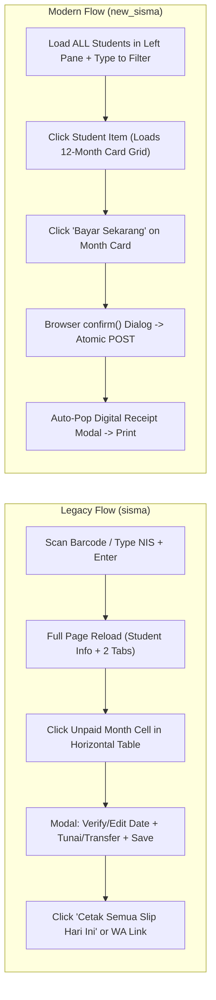

# UX & Behavior Consistency Analysis: Legacy (`sisma`) vs Modern (`new_sisma`)

**Date:** 2026-11-25  
**Legacy System:** `sisma` (Server-rendered PHP + AdminLTE 2 + Bootstrap 3 + jQuery DataTables)  
**Modern System:** `new_sisma` (Next.js 14 Client/Server Hybrid + Tailwind CSS + Modal/SPA Workflows)  

---

## 1. Architectural UX Shift Overview

Migrating from `sisma` to `new_sisma` transitions school staff from a **dense, multi-page AdminLTE 2 back-office interface** (where every search, filter, and form submission triggers a full browser reload and URL query-string mutation like `index.php?view=pembayaran&siswa=697&cari=Cari+Siswa`) to a **modern single-page-style SaaS dashboard** (instant client-side filtering, split-pane selection, and modal dialogs).

While the visual clarity and responsiveness on mobile/tablet devices improve dramatically in `new_sisma`, several **behavioral changes and missing micro-workflows** will disrupt muscle memory for treasurers (*Bendahara*) processing queues of dozens of students during peak morning tuition hours.

---

## 2. Side-by-Side User Journey Comparisons

### Journey 1: Login & Role Entry
| Dimension | Legacy (`sisma`) | Modern (`new_sisma`) | UX Impact |
| :--- | :--- | :--- | :--- |
| **Entry URL** | Root `/` immediately renders staff login (`login.php`), while students use a separate portal (`portal.php` / `index-siswa.php`) and treasurers had `cek_login_bendahara.php`. | Root `/` renders a **Public SaaS Marketing Homepage**; users must click **"Sign In"** to reach `/login`. All roles share one `/login` form. | **Low Friction (Positive, minor adjustment):** Unified `/login` eliminates confusion over separate Admin vs Bendahara login URLs, though internal operators bookmarking `/` now face an extra click unless they bookmark `/login` or `/dashboard`. |
| **Demo / Autofill** | Standard browser form inputs. | Includes clickable **"Akun Demonstrasi Sintetis"** cards on `/login` (`bendahara123`, `admin123`). | **Security/UX Warning:** Great for external review, **must be hidden in production** (`NODE_ENV === 'production'`) so visitors/students do not click demo buttons on the live school portal. |
| **Post-Login Routing** | Redirects to `index.php` (Admin), `index-bendahara.php` (Bendahara), or `index-siswa.php` (Siswa) with distinct menus. | All roles redirect to `/dashboard` with the **exact same 5-item sidebar**. | **Breaking Change for `siswa`:** Students logging in see school-wide revenue KPIs and cash ledgers (and only hit `403` errors when attempting to click "Bayar" or "Simpan"). |

---

### Journey 2: Pay School Fee ("Loket Pembayaran SPP") — *Core Daily Workflow*

| Step / Behavior | Legacy (`sisma`) | Modern (`new_sisma`) | Consistency & Friction Analysis |
| :--- | :--- | :--- | :--- |
| **1. Finding a Student** | Dedicated search box (`Scan Barcode / Masukkan NIS / NISN / Nama Siswa`). Submitting an exact NIS immediately opens that student; ambiguous names show a disambiguation table. | Pre-fetches **all students** into a left-column scrollable list (`max-h-[500px]`), auto-selecting student `#1` on page load. Live client-side filter by `namaSiswa` or `nis` (not `nisn`). | **Breaking Change for Barcode Scanners:** Barcode scanners emit `<NIS><Enter>`. In Legacy, `<Enter>` submits the form and opens the student. In Modern, typing into the filter box filters the list, **but pressing `<Enter>` does not select the matched student**, and `nisn` is not searched in `payments/page.tsx`. Also, pre-loading student `#1` risks accidentally paying for the first student alphabetically! |
| **2. Viewing Obligations** | Two tabs on one screen: **Tab 1: Bulanan** (compact horizontal 12-column row per fee type) and **Tab 2: Lainnya / Bebas** (installment table with batch checkbox). | Only displays **12-Month SPP Cards** (`3 columns x 4 rows`). **No Tab 2 (`Tagihan Bebas`)** is shown even if the student owes Building/Uniform fees. | **Major Functional & UX Regression:** Treasurers cannot see a student's total arrears across non-SPP fees on the counter screen. |
| **3. Payment Input Details** | Clicking a month opens a Bootstrap modal (or inline row in `bayarbulanan`) allowing the treasurer to **edit `tanggal_bayar`** (critical for recording yesterday's bank transfer) and choose **`caraBayar` (`Tunai` / `Transfer`)**. | Clicking `"Bayar Sekarang"` triggers a native browser `window.confirm()` and immediately posts `tglBayar = now()` with exact tariff nominal. | **Breaking Change for Bank Transfers:** Treasurers reconciling bank mutations at the end of the week can no longer set the actual transfer date or mark `Transfer` vs `Tunai`. |
| **4. Multi-Month Checkout** | Treasurer pays months sequentially, then clicks **"Cetak Semua Slip Hari Ini"** (`kwitansi.php`) to hand the parent **one consolidated receipt** for e.g. July–September. | Auto-opens the **Single-Month Receipt Modal** after *every single click*. Paying 3 months requires: Click Jul → Confirm → Close Receipt → Click Aug → Confirm → Close Receipt → Click Sep → Confirm → Print 3 separate receipts! | **High Counter Friction:** Parents paying 3–6 months at once will force 3–6x modal dismissals and waste thermal/A4 paper with separate single-month slips. |
| **5. Error Recovery (Undo)** | Clicking a green `Lunas` cell opens a modal with a red **`Hapus`** button (with confirmation) to revert mistakes immediately. | Paid cards only show **`Lihat Kwitansi`**. No cancel/void action exists. | **High User Anxiety:** One misclick permanently alters `TagihanBulanan` and `Kas` with no UI recovery path. |

---

### Journey 3: View Financial Reports & Arrears ("View Report Card / Laporan")
| Dimension | Legacy (`sisma`) | Modern (`new_sisma`) | UX Impact |
| :--- | :--- | :--- | :--- |
| **Navigation Structure** | 10 separate submenu items under `Laporan` in the left sidebar (`Lap. Pemb. Per Kelas`, `Lap. Tagihan Siswa`, `Rekapitulasi`, `Kondisi Keuangan`, etc.). | Consolidated into **1 menu item**: `Laporan & Asisten AI` (`/dashboard/reports`). | **Cleaner IA, Missing Depth:** Consolidating reports into one hub is great UX, *provided* sub-tabs exist for Class Matrix, Student Arrears, and Cash Recap. Currently only the 12-Month Aggregate Summary table exists. |
| **Executive Insights** | Raw numbers in HTML tables; treasurer manually calculates collection percentages in Excel. | **Claude AI Financial Report Assistant** at the top of `/dashboard/reports` generates plain-Indonesian executive summaries and follow-up recommendations on demand, plus real-time `Rasio Capaian %` badges per month. | **Major UX Upgrade:** Principals (*Kepala Sekolah*) get instant narrative insights without digging through spreadsheets—though if `ANTHROPIC_API_KEY` is unset, the prominent dark purple AI banner occupies ~45% of above-the-fold screen space before the actual financial table. |
| **Printing & Sharing** | Dedicated **"Cetak"** (opens clean Kop Surat popup) and **"Export Excel"** buttons on every report filter box. | No Export or Print buttons on `/dashboard/reports`. | **Workflow Blocker:** Staff cannot submit physical signed monthly reports to the foundation (*Yayasan*) or share class arrears lists with homeroom teachers (*Wali Kelas*). |

---

### Journey 4: Student Management & Class Transitions
| Dimension | Legacy (`sisma`) | Modern (`new_sisma`) | UX Impact |
| :--- | :--- | :--- | :--- |
| **Adding a Student & Billing** | **Two-step mental model:** 1) Add student in `Master Siswa` (no bills created yet). 2) Go to `Keuangan > Jenis Bayar > Setting Tarif` to generate bills per class/student. | **One-step automated model:** Adding a student in `/dashboard/students` **automatically generates 12 monthly SPP bills** for the active academic year. | **Positive Automation, Dangerous Assumption:** Eliminating forgotten bill generation is great UX, *but* hardcoding Rp 250.000 in the background surprises admins if a class has a Rp 125.000 rate or scholarship discount. |
| **Deleting vs Archiving** | Red `[X]` button executes hard `DELETE FROM siswa` with a scary warning: *"Menghapus data siswa akan menghapus data tagihan dan pembayaran!"* | Archive icon executes **Soft-Archive** (`statusSiswa = 'ALUMNI'`), preserving all historical payment and cash audit trails. | **Major Data-Safety Upgrade:** Prevents accidental destruction of historical financial ledgers. However, archived `ALUMNI` students still appear in `/dashboard/students` unless a default `status = AKTIF` filter tab is active! |

---

## 3. Summary of "Breaking Changes" for Existing Users

1. **No Empty Initial State on Payment Counter:** Auto-selecting the first student on `/dashboard/payments` breaks the safety habit where the screen is blank until a student card is scanned or searched.
2. **Loss of Multi-Month Single Receipt (`Kwitansi Gabungan`):** Paying multiple months triggers repetitive single-month receipt modals instead of batching selected months into one receipt.
3. **No Backdated Payment Date or Payment Method (`Tunai` / `Transfer`):** Breaks bank-transfer reconciliation workflows where parents transfer via bank/BRI/BSI on Sunday and send proof to the treasurer on Monday.
4. **Auto-Billing Hardcoded Tariff (`Rp 250.000`):** Diverges silently from SMA Persiapan Stabat's legacy `Rp 125.000` tariff without user input.
5. **Missing "Undo / Batalkan Pembayaran" Button:** Removes the safety net treasurers rely on during fast counter operations.
6. **Unified Staff Sidebar Shown to `siswa` Role:** Breaks role expectations and exposes aggregate school financial figures if student accounts are enabled.

---

## 4. Recommended UX Adjustments to Maintain Familiarity

1. **Adopt "Scan-Ready Empty State + Multi-Select Checkboxes" on `/dashboard/payments`:**
   - Start with an auto-focused search input (`ref.focus()`) supporting **Barcode Scan + `<Enter>`** (`NIS`, `NISN`, or `Nama`), showing a clear empty-state prompt until a student is selected.
   - Add checkboxes on unpaid month cards so treasurers can select **1 to 12 months at once** and click **"Bayar X Bulan Terpilih"**, producing **one consolidated receipt** (with options: *Catat Saja*, *Cetak Slip*, *Kirim WA*).
   - Add optional **"Tanggal Bayar"** (defaulting to today) and **"Metode Bayar (`Tunai` / `Transfer`)"** fields in a compact confirmation modal instead of a bare browser `window.confirm()`.
2. **Add Tabbed Obligations (`SPP Bulanan` | `Tagihan Bebas / Cicilan`) & Admin `Batalkan` Action:**
   - Mirror Legacy's familiar 2-tab layout below the Student Profile Header so both monthly SPP and non-recurring installment fees are visible in one lookup, and include a confirmation-guarded **"Batalkan Bayar"** link on paid items.
3. **Collapsible AI Assistant Drawer/Card on `/dashboard/reports`:**
   - Place the primary **Report Tabs (`Per Kelas`, `Tunggakan Siswa`, `Rekap Kas`, `Ringkasan 12 Bulan`) + Filter Bar + Export Excel / Cetak PDF buttons** at the top of `/dashboard/reports`, and make the **Claude AI Financial Assistant** a collapsible drawer or secondary header card so tabular data remains immediately visible above the fold.
4. **Add Keyboard Shortcut (`Ctrl + K`) & Default `AKTIF` Filter on Student Directory:**
   - Default `/dashboard/students` to `Status: AKTIF` (with filter pills for `Semua`, `Aktif`, `Lulus`, `Pindah`, `Alumni`) and add a quick **"Bayar SPP →"** action button on each student row that deep-links directly to `/dashboard/payments?studentId={id}`.
5. **Hide Synthetic Demo Quick-Fill Buttons in Production:**
   - Gate the `"Akun Demonstrasi Sintetis"` quick-fill block on `/login` behind `process.env.NEXT_PUBLIC_DEMO_MODE === "true"` so production operators see a clean, authoritative school login portal.
